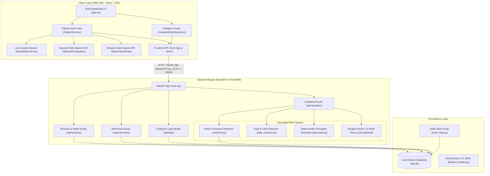
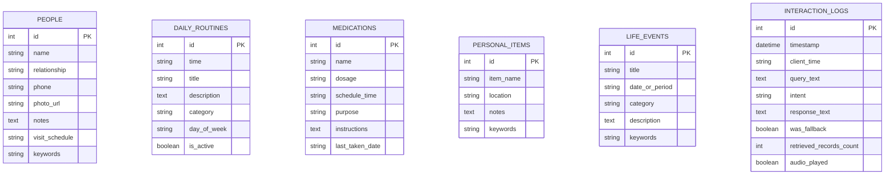
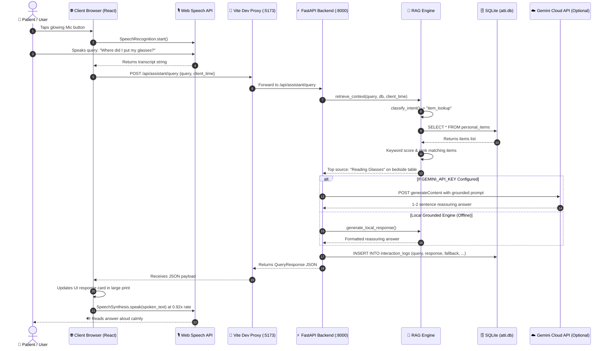
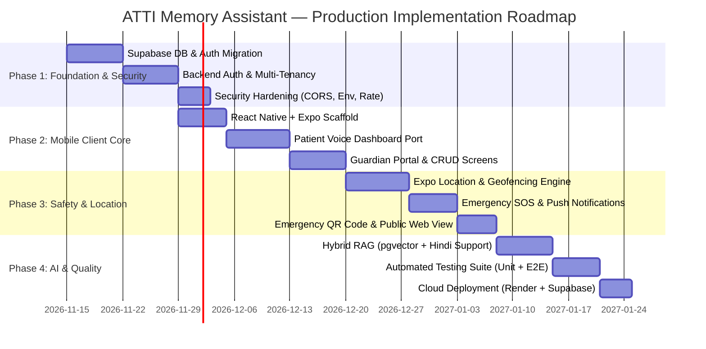

# Comprehensive Technical Audit Report: ATTI Dementia Memory Assistant

**Repository:** `https://github.com/Parulsri1616/atti-memory-assistant.git`
**Audit Date:** November 12, 2026
**Auditor:** Senior Software Architect, Full-Stack Engineer, Mobile Application Auditor & Application Security Reviewer
**Audit Mode:** Strictly Read-Only Source Code Inspection
**Report Version:** 1.0.0 (Production-Grade Audit)

---

## Executive Summary

This report delivers an exhaustive, evidence-based architectural, functional, security, and code quality audit of the **ATTI (Dementia Memory Assistant)** repository in its current state. Every finding in this document is derived from direct inspection of the codebase.

The current implementation represents a functional **desktop/web proof-of-concept (PoC)** built as a final-year academic project (Department of Computer Science & Engineering, Delhi Technical Campus, GGSIPU, Academic Year 2026–27). It couples a **React 18 + Vite** single-page web frontend with a **FastAPI + SQLite** backend engine implementing a specialized grounded Retrieval-Augmented Generation (RAG) system for individuals with mild dementia.

### Key Metrics Summary
| Metric | Value | Audit Notes |
|---|---|---|
| **Repository State** | Active Git repository (2 commits: `73d8d5c`, `b9785d6`) | Main branch clean, working tree clean |
| **Frontend Screens / Views** | **2 Primary Views** (`PatientView`, `CaregiverDashboard`) containing **7 Sub-interfaces** | No client-side routing; toggled via state in [App.tsx](file:///Users/mahekaghija/Desktop/atti/atti/frontend/src/App.tsx#L8) |
| **Backend Endpoints** | **24 Total Endpoints** (1 root + 23 API endpoints) | Grouped under 4 API routers (`assistant`, `routines`, `memories`, `logs`) + 1 root |
| **Database Models** | **6 SQLAlchemy Models / Tables** | `people`, `daily_routines`, `medications`, `personal_items`, `life_events`, `interaction_logs` |
| **Overall Readiness vs Intended Production Spec** | **~25%** | Working memory RAG PoC, but missing mobile architecture, Supabase, Auth, GPS, SOS, and Safety |
| **Test Coverage** | **0%** | Zero automated tests (unit, integration, or E2E) across backend and frontend |
| **Critical Security Vulnerabilities** | **2 Critical, 3 High, 2 Medium** | Zero authentication, unprotected caregiver portal, CORS credentials wildcard, unencrypted health data |

---

## Part 1 — Project Overview & Architecture

### 1.1 Application Purpose & Target Audience
ATTI is designed as a conversational memory assistant for individuals experiencing mild cognitive impairment (MCI) and early-to-mid stage dementia. The core objective is to reverse the cognitive burden of conventional digital organizers (calendars, to-do lists, reminder apps) by replacing complex menus and typing with an accessible, voice-first interface that provides gentle, spoken, and visual reassurance grounded strictly in verified personal facts.

The system serves two distinct user personas:
1. **The Patient (Older Adult with Dementia):** Requires high-contrast, large typography, calm color palettes, single-tap voice interaction, scheduled orientation, and immediate spoken answers to repetitive questions (*"Who is Rahul?"*, *"Where are my glasses?"*, *"What do I do today?"*, *"Did I take my medicine?"*).
2. **The Caregiver / Family Member:** Requires administrative oversight to configure daily routines, family profiles, medication schedules, personal item locations, and life memories, while monitoring clinical indicators such as repetitive question frequency and ungrounded queries.

### 1.2 Current Architecture vs Expected Production Architecture
- **Current Repository Architecture:** A decoupled Web Single-Page Application (SPA) communicating over HTTP/REST with a local Python FastAPI microservice backed by SQLite (`atti.db`). Speech input and output rely strictly on the client browser's Web Speech API (`webkitSpeechRecognition` and `SpeechSynthesis`).
- **Expected Production Architecture:** A cross-platform native mobile application built with **React Native + Expo**, connecting to a **FastAPI cloud backend** hosted on Render, integrating **Supabase PostgreSQL, Supabase Auth, Realtime, and Storage**, utilizing **native GPS geofencing and push notifications (FCM/APNs)**, and offering emergency QR code public workflows.



### 1.3 Detailed Technology Inventory
- **Frontend Core:** React 18.2.0, TypeScript 5.2.2, Vite 5.1.6.
- **Styling & Assets:** Tailwind CSS 3.4.1, PostCSS 8.4.35, Autoprefixer 10.4.18, Lucide React 0.344.0 (iconography).
- **Backend Core:** Python 3.10+, FastAPI >= 0.110.0, Starlette, Uvicorn[standard] >= 0.28.0, Pydantic v2 >= 2.6.0.
- **Persistence & ORM:** SQLAlchemy >= 2.0.28, SQLite 3 (`atti.db`).
- **AI / LLM Integrations:**
  - *Built-in Offline Engine:* Deterministic rule-based template assembler guaranteeing zero hallucination.
  - *Cloud LLM:* Google Gemini 1.5 Flash REST API (`requests.post` to `generativelanguage.googleapis.com`).
  - *OpenAI:* Mentioned in [config.py](file:///Users/mahekaghija/Desktop/atti/atti/backend/app/config.py#L18), but **no execution logic exists in the codebase**.
- **External Dependencies & Services:**
  - Google Gemini REST API (when `GEMINI_API_KEY` is supplied).
  - Browser Native Web Speech API (depends on browser engine: Chromium, Safari, or Gecko).
- **Authentication:** **Completely absent**. No tokens, no sessions, no user records.

---

## Part 2 — Complete Frontend Audit

### 2.1 Framework, Version & Setup
- **Framework:** React 18.2.0 ([package.json:13](file:///Users/mahekaghija/Desktop/atti/atti/frontend/package.json#L13)) running on top of Vite 5.1.6 ([package.json:24](file:///Users/mahekaghija/Desktop/atti/atti/frontend/package.json#L24)).
- **Build & Development Tooling:** Vite dev server on port 5173 with reverse proxy configured in [vite.config.ts](file:///Users/mahekaghija/Desktop/atti/atti/frontend/vite.config.ts#L9-L15) forwarding `/api` calls to `http://127.0.0.1:8000`.
- **Entry Point:** [index.html](file:///Users/mahekaghija/Desktop/atti/atti/frontend/index.html#L1-L15) boots [src/main.tsx](file:///Users/mahekaghija/Desktop/atti/atti/frontend/src/main.tsx#L1-L11), which renders `<App />` within `React.StrictMode`.

### 2.2 Directory Structure
```
atti/frontend/
├── index.html                  # HTML5 shell with viewport & meta headers
├── package.json                # Dependencies and build scripts
├── package-lock.json           # Lockfile for reproducible installs
├── postcss.config.js           # PostCSS Tailwind plugins
├── tailwind.config.js          # Custom colors (atti-*, calm-*) and font configurations
├── tsconfig.json               # TypeScript compiler config (strict: true, ES2020)
├── vite.config.ts              # Vite dev server + /api proxy config
└── src/
    ├── App.tsx                 # Root coordinator, simulator banner & mode switcher
    ├── main.tsx                # React DOM mount point
    ├── index.css               # Tailwind directives & CSS keyframe animations
    ├── types/
    │   └── index.ts            # TypeScript interfaces for models & API payloads
    ├── services/
    │   ├── api.ts              # Fetch-based API client for all backend endpoints
    │   └── speech.ts           # SpeechService wrapper around Web Speech API
    └── components/
        ├── PatientView.tsx     # Large-print, voice-activated patient UI
        ├── CaregiverDashboard.tsx # Multi-tab CRUD administrative portal
        └── RoutineBanner.tsx   # Live digital clock, date, and next scheduled routine
```

### 2.3 Navigation Architecture
The frontend **does not use a routing library** (no `react-router-dom` or similar package). Navigation is managed through a single state variable `viewMode` in [App.tsx:8](file:///Users/mahekaghija/Desktop/atti/atti/frontend/src/App.tsx#L8):
- `viewMode === 'patient'`: Renders [PatientView.tsx](file:///Users/mahekaghija/Desktop/atti/atti/frontend/src/components/PatientView.tsx).
- `viewMode === 'caregiver'`: Renders [CaregiverDashboard.tsx](file:///Users/mahekaghija/Desktop/atti/atti/frontend/src/components/CaregiverDashboard.tsx).
- In addition, [App.tsx:9](file:///Users/mahekaghija/Desktop/atti/atti/frontend/src/App.tsx#L9) provides a `deviceFrame` toggle to view the patient interface either in a simulated mobile device frame with speaker notch (`max-w-md h-[92vh]`) or in full width.

### 2.4 Screen & View Inventory

| View / Component | Purpose | Implemented Functionality | Backend Integration | Completion Status |
|---|---|---|---|---|
| **Simulator Control Bar** ([App.tsx:18-68](file:///Users/mahekaghija/Desktop/atti/atti/frontend/src/App.tsx#L18-L68)) | Top utility bar for academic demo | Switches between Patient and Caregiver modes; toggles mobile frame simulator; calls `/api/assistant/status` on mount | Connected (`api.getSystemStatus`) | **Fully Implemented (PoC demo bar)** |
| **RoutineBanner** ([RoutineBanner.tsx](file:///Users/mahekaghija/Desktop/atti/atti/frontend/src/components/RoutineBanner.tsx)) | Cognitive orientation | 15-second polling interval updating day, date, 12-hour spoken time format, period of day (morning/afternoon/evening/night), and next routine card | Connected (`api.getCurrentBanner`) | **Fully Implemented** |
| **Patient Central Voice Action** ([PatientView.tsx:187-281](file:///Users/mahekaghija/Desktop/atti/atti/frontend/src/components/PatientView.tsx#L187-L281)) | Primary patient query interface | Big pulsating microphone button, visual feedback for listening/speaking states, Web Speech STT recognition, fallback expandable text input box | Connected (`api.askAssistant`) | **Fully Implemented (Browser dependent)** |
| **Patient Spoken Response Card** ([PatientView.tsx:284-373](file:///Users/mahekaghija/Desktop/atti/atti/frontend/src/components/PatientView.tsx#L284-L373)) | Displays grounded answers | Displays user query, large-print response, grounded badge, "Listen Again" TTS replay button, "Stop Voice" button | Connected (`speechService.speak`) | **Fully Implemented** |
| **Patient Caregiver Fallback** ([PatientView.tsx:353-370](file:///Users/mahekaghija/Desktop/atti/atti/frontend/src/components/PatientView.tsx#L353-L370)) | Assist patient when query ungrounded | "Ask Rahul For Me" button shown when `is_fallback == true` | **Mock / Local UI Only** (`handleNotifyCaregiver` only flips local state `caregiverNotified = true`; sends no notification or backend request) | **UI Mock Only** |
| **Patient Quick-Tap Prompts** ([PatientView.tsx:376-393](file:///Users/mahekaghija/Desktop/atti/atti/frontend/src/components/PatientView.tsx#L376-L393)) | Pill buttons for common queries | Fetches suggestions from backend and executes query on tap | Connected (`api.getSuggestions`) | **Fully Implemented** |
| **Caregiver Overview & Analytics** ([CaregiverDashboard.tsx:204-392](file:///Users/mahekaghija/Desktop/atti/atti/frontend/src/components/CaregiverDashboard.tsx#L204-L392)) | Clinical repetition & accuracy tracking | 4 KPI cards (Total queries, Grounded accuracy, Fallbacks, Active memories), Repetitive questions list, Unanswered queries list, Interaction logs table, Clear logs button | Connected (`api.getAnalytics`, `api.getLogs`, `api.clearLogs`) | **Fully Implemented** |
| **Caregiver People & Family** ([CaregiverDashboard.tsx:395-467](file:///Users/mahekaghija/Desktop/atti/atti/frontend/src/components/CaregiverDashboard.tsx#L395-L467)) | Directory of loved ones and doctors | List cards with name, relationship, visit schedule, phone, notes; delete action; Add Person modal form | Connected (`api.getPeople`, `api.createPerson`, `api.deletePerson`) | **Fully Implemented** |
| **Caregiver Daily Routines** ([CaregiverDashboard.tsx:470-526](file:///Users/mahekaghija/Desktop/atti/atti/frontend/src/components/CaregiverDashboard.tsx#L470-L526)) | Routine creation & listing | List routines with time badge, title, category, description; delete action; Add Routine modal form | Connected (`api.getRoutines`, `api.createRoutine`, `api.deleteRoutine`) | **Fully Implemented** |
| **Caregiver Medications** ([CaregiverDashboard.tsx:529-604](file:///Users/mahekaghija/Desktop/atti/atti/frontend/src/components/CaregiverDashboard.tsx#L529-L604)) | Medication schedule management | List medications with dosage, schedule time, instructions, "Mark Taken Today" action; delete action; Add Medication modal form | Connected (`api.getMedications`, `api.createMedication`, `api.deleteMedication`, `api.logMedicationTaken`) | **Fully Implemented** |
| **Caregiver Personal Items** ([CaregiverDashboard.tsx:607-667](file:///Users/mahekaghija/Desktop/atti/atti/frontend/src/components/CaregiverDashboard.tsx#L607-L667)) | Lost & found location directory | List items with location and notes; delete action; Add Item modal form | Connected (`api.getItems`, `api.createItem`, `api.deleteItem`) | **Fully Implemented** |
| **Caregiver Reminiscence Stories** ([CaregiverDashboard.tsx:670-728](file:///Users/mahekaghija/Desktop/atti/atti/frontend/src/components/CaregiverDashboard.tsx#L670-L728)) | Preserves identity and memories | List life events with date/period, description; delete action; Add Memory modal form | Connected (`api.getEvents`, `api.createEvent`, `api.deleteEvent`) | **Fully Implemented** |
| **Caregiver Modal Form** ([CaregiverDashboard.tsx:731-976](file:///Users/mahekaghija/Desktop/atti/atti/frontend/src/components/CaregiverDashboard.tsx#L731-L976)) | Shared popup form for creating entities | Switches form fields depending on active tab; handles validation and submissions | Connected to respective API methods | **Fully Implemented** |

### 2.5 Speech Recognition & Synthesis Engine
The speech subsystem is encapsulated in [src/services/speech.ts](file:///Users/mahekaghija/Desktop/atti/atti/frontend/src/services/speech.ts):
- **Speech-to-Text (STT):** Checks `window.SpeechRecognition || window.webkitSpeechRecognition`. Sets `continuous = false`, `interimResults = false`, and `lang = 'en-IN'`.
- **Text-to-Speech (TTS):** Uses `window.speechSynthesis`. Configures `SpeechSynthesisUtterance` with a calm rate of `0.92x` and `pitch = 1.0` ([speech.ts:94](file:///Users/mahekaghija/Desktop/atti/atti/frontend/src/services/speech.ts#L94)). It searches for available voices matching `en-IN`, `en-GB`, or `en-US` with names containing `Natural`, `Google`, or `Samantha`.
- **Limitations:**
  1. The Web Speech API is dependent on the host browser and operating system. In browsers without speech support or when microphone permissions are denied, STT fails with a localized error message.
  2. The code specifies `lang = 'en-IN'` only; **Hindi speech recognition and synthesis are completely unconfigured**.
  3. Audio playback can be blocked if user interaction policies are not met before calling `speechSynthesis.speak()`.

---

## Part 3 — Complete Backend Audit

### 3.1 Framework & Entry Points
- **Framework:** FastAPI >= 0.110.0 running on Uvicorn >= 0.28.0 ([requirements.txt:1-2](file:///Users/mahekaghija/Desktop/atti/atti/backend/requirements.txt#L1-L2)).
- **Entry Points:**
  - [run.py](file:///Users/mahekaghija/Desktop/atti/atti/backend/run.py#L1-L5): `python backend/run.py` launches Uvicorn on `0.0.0.0:8000` with `reload=True`.
  - [app/main.py](file:///Users/mahekaghija/Desktop/atti/atti/backend/app/main.py#L45-L48): Contains direct execution block `uvicorn.run("backend.app.main:app", ...)`.
- **Database Initialization & Seeding on Startup:**
  In [app/main.py:9-13](file:///Users/mahekaghija/Desktop/atti/atti/backend/app/main.py#L9-L13), table generation (`Base.metadata.create_all(bind=engine)`) and seed execution (`seed_database_if_empty(db)`) are executed unconditionally at **module import time**, rather than within a lifespan context manager.

### 3.2 Directory Structure
```
atti/backend/
├── requirements.txt            # Python dependencies
├── run.py                      # Uvicorn entry script
└── app/
    ├── __init__.py
    ├── config.py               # Settings class loaded via python-dotenv
    ├── database.py             # SQLAlchemy engine & SessionLocal factory
    ├── models.py               # SQLAlchemy ORM table definitions
    ├── schemas.py              # Pydantic v2 validation models
    ├── seed_data.py            # Initial seed population logic
    ├── main.py                 # FastAPI application, CORS, router mounting
    ├── rag/
    │   ├── date_resolver.py    # Temporal arithmetic & clock understanding
    │   ├── retriever.py        # Intent classification & DB keyword search
    │   └── generator.py        # Grounded answer synthesis (Local & Gemini)
    └── routers/
        ├── assistant.py        # /api/assistant endpoints
        ├── routines.py         # /api/routines & /api/routines/medications endpoints
        ├── memories.py         # /api/memories (people, items, events) endpoints
        └── logs.py             # /api/logs endpoints & analytics calculations
```

### 3.3 Complete Backend API Inventory (24 Endpoints)

| # | Endpoint | Method | Router File & Lines | Purpose | Auth | Request Model / Params | Response Model / Structure | Status |
|---|---|---|---|---|---|---|---|---|
| 1 | `/` | `GET` | [main.py:36-43](file:///Users/mahekaghija/Desktop/atti/atti/backend/app/main.py#L36-L43) | Service root health and documentation link | None | None | `{project, version, status, docs_url}` | **Fully Implemented** |
| 2 | `/api/assistant/query` | `POST` | [assistant.py:13-55](file:///Users/mahekaghija/Desktop/atti/atti/backend/app/routers/assistant.py#L13-L55) | Evaluates patient query, runs RAG, writes interaction log | None | `QueryRequest` (query: str, client_time: str, user_id: str) | `QueryResponse` (answer, intent, is_fallback, confidence, sources, spoken_text) | **Fully Implemented** |
| 3 | `/api/assistant/prompt-suggestions` | `GET` | [assistant.py:57-70](file:///Users/mahekaghija/Desktop/atti/atti/backend/app/routers/assistant.py#L57-L70) | Returns 8 suggested quick-tap prompts | None | None | `{suggestions: string[]}` | **Fully Implemented** |
| 4 | `/api/assistant/status` | `GET` | [assistant.py:72-80](file:///Users/mahekaghija/Desktop/atti/atti/backend/app/routers/assistant.py#L72-L80) | Reports system status, patient/caregiver names, and LLM mode | None | None | `{status, patient_name, caregiver_name, llm_engine, offline_ready}` | **Fully Implemented** |
| 5 | `/api/routines` | `GET` | [routines.py:13-15](file:///Users/mahekaghija/Desktop/atti/atti/backend/app/routers/routines.py#L13-L15) | Lists daily routines ordered by ascending time | None | None | `List[RoutineOut]` | **Fully Implemented** |
| 6 | `/api/routines` | `POST` | [routines.py:17-23](file:///Users/mahekaghija/Desktop/atti/atti/backend/app/routers/routines.py#L17-L23) | Creates a new daily routine | None | `RoutineCreate` | `RoutineOut` | **Fully Implemented** |
| 7 | `/api/routines/{routine_id}` | `DELETE` | [routines.py:25-32](file:///Users/mahekaghija/Desktop/atti/atti/backend/app/routers/routines.py#L25-L32) | Deletes a daily routine by ID | None | `routine_id: int` (Path) | `{"message": "Routine deleted"}` | **Fully Implemented** |
| 8 | `/api/routines/current-banner` | `GET` | [routines.py:34-64](file:///Users/mahekaghija/Desktop/atti/atti/backend/app/routers/routines.py#L34-L64) | Resolves client clock & finds active/upcoming routine | None | `client_time: Optional[str]` (Query) | `{time_info, active_routine, upcoming_count}` | **Fully Implemented** |
| 9 | `/api/routines/medications` | `GET` | [routines.py:67-69](file:///Users/mahekaghija/Desktop/atti/atti/backend/app/routers/routines.py#L67-L69) | Lists all medication prescriptions | None | None | `List[MedicationOut]` | **Fully Implemented** |
| 10 | `/api/routines/medications` | `POST` | [routines.py:71-77](file:///Users/mahekaghija/Desktop/atti/atti/backend/app/routers/routines.py#L71-L77) | Creates a new medication entry | None | `MedicationCreate` | `MedicationOut` | **Fully Implemented** |
| 11 | `/api/routines/medications/{med_id}` | `DELETE` | [routines.py:79-86](file:///Users/mahekaghija/Desktop/atti/atti/backend/app/routers/routines.py#L79-L86) | Deletes a medication by ID | None | `med_id: int` (Path) | `{"message": "Medication deleted"}` | **Fully Implemented** |
| 12 | `/api/routines/medications/{med_id}/log-taken` | `POST` | [routines.py:88-95](file:///Users/mahekaghija/Desktop/atti/atti/backend/app/routers/routines.py#L88-L95) | Records current timestamp as `last_taken_date` | None | `med_id: int` (Path) | `{"message", "last_taken"}` | **Fully Implemented** |
| 13 | `/api/memories/people` | `GET` | [memories.py:15-17](file:///Users/mahekaghija/Desktop/atti/atti/backend/app/routers/memories.py#L15-L17) | Lists all family members and doctors | None | None | `List[PersonOut]` | **Fully Implemented** |
| 14 | `/api/memories/people` | `POST` | [memories.py:19-25](file:///Users/mahekaghija/Desktop/atti/atti/backend/app/routers/memories.py#L19-L25) | Adds a person record | None | `PersonCreate` | `PersonOut` | **Fully Implemented** |
| 15 | `/api/memories/people/{person_id}` | `DELETE` | [memories.py:27-34](file:///Users/mahekaghija/Desktop/atti/atti/backend/app/routers/memories.py#L27-L34) | Deletes a person record | None | `person_id: int` (Path) | `{"message": "Person deleted"}` | **Fully Implemented** |
| 16 | `/api/memories/items` | `GET` | [memories.py:37-39](file:///Users/mahekaghija/Desktop/atti/atti/backend/app/routers/memories.py#L37-L39) | Lists personal item locations | None | None | `List[PersonalItemOut]` | **Fully Implemented** |
| 17 | `/api/memories/items` | `POST` | [memories.py:41-47](file:///Users/mahekaghija/Desktop/atti/atti/backend/app/routers/memories.py#L41-L47) | Adds a personal item location | None | `PersonalItemCreate` | `PersonalItemOut` | **Fully Implemented** |
| 18 | `/api/memories/items/{item_id}` | `DELETE` | [memories.py:49-56](file:///Users/mahekaghija/Desktop/atti/atti/backend/app/routers/memories.py#L49-L56) | Deletes a personal item | None | `item_id: int` (Path) | `{"message": "Item deleted"}` | **Fully Implemented** |
| 19 | `/api/memories/events` | `GET` | [memories.py:59-61](file:///Users/mahekaghija/Desktop/atti/atti/backend/app/routers/memories.py#L59-L61) | Lists life events / reminiscence memories | None | None | `List[LifeEventOut]` | **Fully Implemented** |
| 20 | `/api/memories/events` | `POST` | [memories.py:63-69](file:///Users/mahekaghija/Desktop/atti/atti/backend/app/routers/memories.py#L63-L69) | Adds a life event record | None | `LifeEventCreate` | `LifeEventOut` | **Fully Implemented** |
| 21 | `/api/memories/events/{event_id}` | `DELETE` | [memories.py:71-78](file:///Users/mahekaghija/Desktop/atti/atti/backend/app/routers/memories.py#L71-L78) | Deletes a life event | None | `event_id: int` (Path) | `{"message": "Life event deleted"}` | **Fully Implemented** |
| 22 | `/api/logs` | `GET` | [logs.py:11-13](file:///Users/mahekaghija/Desktop/atti/atti/backend/app/routers/logs.py#L11-L13) | Returns recent interaction logs | None | `limit: int = 50` (Query) | `List[InteractionLogOut]` | **Fully Implemented** |
| 23 | `/api/logs/analytics` | `GET` | [logs.py:15-56](file:///Users/mahekaghija/Desktop/atti/atti/backend/app/routers/logs.py#L15-L56) | Aggregates repetition counts, accuracy, fallbacks | None | None | `DashboardStats` dictionary | **Fully Implemented** |
| 24 | `/api/logs/clear` | `DELETE` | [logs.py:58-62](file:///Users/mahekaghija/Desktop/atti/atti/backend/app/routers/logs.py#L58-L62) | Deletes all interaction logs | None | None | `{"message": "All interaction logs cleared"}` | **Fully Implemented** |

### 3.4 RAG Engine Deep-Dive
The RAG pipeline does not use embedding models, vector stores, or third-party retrieval frameworks. It uses a **custom lexical-semantic heuristics engine**:
1. **Date & Temporal Resolver ([date_resolver.py](file:///Users/mahekaghija/Desktop/atti/atti/backend/app/rag/date_resolver.py)):**
   - Parses the client's local ISO timestamp (`client_time`) or falls back to server clock.
   - Computes human-friendly period strings (`morning` for 5–12, `afternoon` for 12–17, `evening` for 17–21, `night` for 21–5).
   - Resolves direct time queries (*"what time is it"*, *"kitne baje"*, *"samay kya"*) and calendar queries (*"what day is today"*, *"aaj kaun sa din"*).
2. **Intent Classifier & Retriever ([retriever.py](file:///Users/mahekaghija/Desktop/atti/atti/backend/app/rag/retriever.py)):**
   - Classifies query text into one of 7 intents: `time_date`, `medication_lookup`, `item_lookup`, `person_lookup`, `routine_lookup`, `event_recall`, or `conversational`.
   - Queries the corresponding SQLAlchemy table using `db.query(...).all()` and computes a scoring heuristic in Python memory based on keyword presence and token overlaps.
   - Truncates retrieved sources to the top 3 highest-scoring items (`sources[:3]`).
3. **Grounded Response Generator ([generator.py](file:///Users/mahekaghija/Desktop/atti/atti/backend/app/rag/generator.py)):**
   - If `GEMINI_API_KEY` is present, formats a strict dementia prompt and issues a REST call to `gemini-1.5-flash` with temperature `0.2` and `maxOutputTokens: 100`.
   - If no key is set or the API fails, executes `generate_local_response()` which constructs templated natural language strings directly from `sources[0]`.
   - When no sources are retrieved, it strictly outputs the reassuring fallback:
     `"I am not sure about that. Would you like me to ask your caregiver Rahul?"` ([generator.py:63](file:///Users/mahekaghija/Desktop/atti/atti/backend/app/rag/generator.py#L63)).

### 3.5 Discrepancies Between README Claims and Code
1. **APScheduler Claim:** README Section 4 lists *"Scheduling: APScheduler for routine triggers"*, and `apscheduler>=3.10.4` is in `requirements.txt`. However, **`apscheduler` is never imported or initialized anywhere in the codebase**. There are no background jobs, no cron triggers, and no proactive routine notifications.
2. **OpenAI Support Claim:** [config.py:18](file:///Users/mahekaghija/Desktop/atti/atti/backend/app/config.py#L18) lists `OPENAI_API_KEY`, but `generator.py` contains **zero code to invoke the OpenAI API**.
3. **Update (PUT/PATCH) Endpoints Missing:** The API supports `GET`, `POST`, and `DELETE` on memories and routines, but **no `PUT` or `PATCH` endpoints exist**. To edit a routine or person, the caregiver must delete and recreate the record.

---

## Part 4 — Database and Data Flow

### 4.1 Database Technology
- **Engine:** SQLite 3 via SQLAlchemy 2.0 ORM.
- **Connection Configuration:** `DATABASE_URL = "sqlite:///{BASE_DIR}/atti.db"`. Configured with `connect_args={"check_same_thread": False}` in [database.py:6](file:///Users/mahekaghija/Desktop/atti/atti/backend/app/database.py#L6) to accommodate FastAPI's multithreaded worker threads.
- **Migrations:** **None**. There is no Alembic setup, no migration scripts, and no version tracking. Tables are created on import via `Base.metadata.create_all(bind=engine)`.
- **Concurrency & Scaling Limitations:** SQLite uses file-level locking during writes (`BEGIN IMMEDIATE`). Under multiple simultaneous users or mobile clients, write contention will produce `sqlite3.OperationalError: database is locked`.

### 4.2 Data Models & Relationships



### 4.3 Key Structural Observations on Data Models
1. **Zero Foreign Keys / Relationships:** There are **no relational foreign keys anywhere in the schema**. All 6 models are completely detached tables.
2. **Missing Multi-Tenancy / User Context:** There is no `users`, `patients`, `caregivers`, or `profiles` table. Every record in `people`, `medications`, `routines`, and `items` belongs to a single global scope.
3. **Missing Critical Dementia Support Tables:**
   - No `safe_zones` / `geofences` table (coordinates, radius, patient_id).
   - No `locations` / `gps_breadcrumbs` table (lat, lng, speed, accuracy, recorded_at).
   - No `emergency_contacts` / `sos_alerts` table.
   - No `qr_codes` / `public_assistance_tokens` table.
4. **Data Persistence vs Mock:** Data is persistent across restarts in `atti.db`. On initial run when `db.query(Person).first()` is null, [seed_data.py](file:///Users/mahekaghija/Desktop/atti/atti/backend/app/seed_data.py#L4-L180) automatically injects 4 people, 5 daily routines, 3 medications, 4 personal items, and 4 life events representing patient "Shashi Sharma" and son "Rahul".

### 4.4 End-to-End Data Flow Diagram



---

## Part 5 — Feature-by-Feature Functional Audit

| Feature Name | Intended Behavior | Implementation Location | Technical Mechanism | Backend Connected | End-to-End Status | Deficiencies & Gaps |
|---|---|---|---|---|---|---|
| **Voice-First Input (STT)** | Capture spoken speech from patient without typing | [speech.ts:36-78](file:///Users/mahekaghija/Desktop/atti/atti/frontend/src/services/speech.ts#L36-L78), [PatientView.tsx:67-92](file:///Users/mahekaghija/Desktop/atti/atti/frontend/src/components/PatientView.tsx#L67-L92) | Wraps browser `SpeechRecognition` API with event callbacks for transcript and errors | Yes | **Partially Implemented** | Dependent on desktop/browser Web Speech API; fails silently on unsupported browsers; hardcoded to `en-IN` with no Hindi support. |
| **Spoken Delivery (TTS)** | Read assistant response aloud in a calm tone | [speech.ts:87-115](file:///Users/mahekaghija/Desktop/atti/atti/frontend/src/services/speech.ts#L87-L115), [PatientView.tsx:107-112](file:///Users/mahekaghija/Desktop/atti/atti/frontend/src/components/PatientView.tsx#L107-L112) | `window.speechSynthesis` with `rate = 0.92`, filtering natural English voices | Yes | **Partially Implemented** | Dependent on browser TTS engine; no Hindi TTS voice selection; stops if browser tab loses focus. |
| **Listen Again (Replay)** | Allow patient to replay last spoken answer with 1 tap | [PatientView.tsx:127-134](file:///Users/mahekaghija/Desktop/atti/atti/frontend/src/components/PatientView.tsx#L127-L134) | Calls `speechService.speak(lastResponse.spoken_text)` | Yes | **Fully Implemented** | None. Works reliably when audio is available. |
| **Temporal Orientation Banner** | Display live date, day of week, digital clock, and active routine | [RoutineBanner.tsx:25-65](file:///Users/mahekaghija/Desktop/atti/atti/frontend/src/components/RoutineBanner.tsx#L25-L65) | 15s `setInterval` timer polling local system clock + `GET /api/routines/current-banner` | Yes | **Fully Implemented** | Polls HTTP every 15s rather than using local clock arithmetic with push invalidation. |
| **Quick-Tap Suggestions** | Suggest frequent questions for patients who struggle with word recall | [PatientView.tsx:48-53](file:///Users/mahekaghija/Desktop/atti/atti/frontend/src/components/PatientView.tsx#L48-L53), [assistant.py:57-70](file:///Users/mahekaghija/Desktop/atti/atti/backend/app/routers/assistant.py#L57-L70) | `GET /api/assistant/prompt-suggestions` returns 8 static prompts | Yes | **Fully Implemented** | Prompts are static and not dynamically personalized to the patient's schedule or time of day. |
| **Grounded Memory RAG** | Synthesize 1-2 sentence answers grounded strictly in stored records | [retriever.py:45-202](file:///Users/mahekaghija/Desktop/atti/atti/backend/app/rag/retriever.py#L45-L202), [generator.py:20-159](file:///Users/mahekaghija/Desktop/atti/atti/backend/app/rag/generator.py#L20-L159) | Keyword match against SQLite + local template assembler or Gemini API fallback | Yes | **Fully Implemented** | Uses naive lexical matching instead of vector semantic embeddings; multi-word phrasing variations may fail. |
| **Zero-Hallucination Fallback** | Fall back gently to asking caregiver when facts are missing | [generator.py:61-66](file:///Users/mahekaghija/Desktop/atti/atti/backend/app/rag/generator.py#L61-L66) | Returns `"I am not sure about that. Would you like me to ask your caregiver {name}?"` | Yes | **Fully Implemented** | Works reliably. Strictly protects against ungrounded hallucinations. |
| **Ask Caregiver Button** | Notify caregiver when patient needs help on ungrounded query | [PatientView.tsx:149-151](file:///Users/mahekaghija/Desktop/atti/atti/frontend/src/components/PatientView.tsx#L149-L151) | Sets local React state `setCaregiverNotified(true)` | No | **UI Mock Only** | **No network request, SMS, push notification, or backend record is created**. |
| **Repetitive Question Analytics** | Detect frequency of identical queries to assess short-term memory | [logs.py:21-29](file:///Users/mahekaghija/Desktop/atti/atti/backend/app/routers/logs.py#L21-L29), [CaregiverDashboard.tsx:254-286](file:///Users/mahekaghija/Desktop/atti/atti/frontend/src/components/CaregiverDashboard.tsx#L254-L286) | SQL `GROUP BY query_text HAVING count > 1 ORDER BY count DESC` | Yes | **Fully Implemented** | Requires exact string equality; slight variations in phrasing are counted as separate queries. |
| **Caregiver People Directory** | Manage family and physician profiles | [memories.py:15-35](file:///Users/mahekaghija/Desktop/atti/atti/backend/app/routers/memories.py#L15-L35), [CaregiverDashboard.tsx:395-467](file:///Users/mahekaghija/Desktop/atti/atti/frontend/src/components/CaregiverDashboard.tsx#L395-L467) | CRUD operations (List, Create, Delete) on `people` table | Yes | **Fully Implemented** | No photo upload capability (schema has `photo_url` but UI has no upload); no edit endpoint. |
| **Daily Routine Management** | Manage scheduled activities and routines | [routines.py:13-32](file:///Users/mahekaghija/Desktop/atti/atti/backend/app/routers/routines.py#L13-L32), [CaregiverDashboard.tsx:470-526](file:///Users/mahekaghija/Desktop/atti/atti/frontend/src/components/CaregiverDashboard.tsx#L470-L526) | CRUD operations (List, Create, Delete) on `daily_routines` table | Yes | **Fully Implemented** | No edit capability; no days-of-week selection in UI (hardcoded to 'daily'). |
| **Medication Management** | Manage medications and log taken doses | [routines.py:67-95](file:///Users/mahekaghija/Desktop/atti/atti/backend/app/routers/routines.py#L67-L95), [CaregiverDashboard.tsx:529-604](file:///Users/mahekaghija/Desktop/atti/atti/frontend/src/components/CaregiverDashboard.tsx#L529-L604) | List, Add, Delete, and `POST /log-taken` timestamp update | Yes | **Fully Implemented** | `log-taken` only records one timestamp on the medication row; no historical log of doses taken across days. |
| **Personal Items Tracker** | Manage locations of everyday misplaced items | [memories.py:37-56](file:///Users/mahekaghija/Desktop/atti/atti/backend/app/routers/memories.py#L37-L56), [CaregiverDashboard.tsx:607-667](file:///Users/mahekaghija/Desktop/atti/atti/frontend/src/components/CaregiverDashboard.tsx#L607-L667) | List, Add, Delete on `personal_items` table | Yes | **Fully Implemented** | No edit capability. |
| **Reminiscence Stories** | Preserve life memories and identity | [memories.py:59-78](file:///Users/mahekaghija/Desktop/atti/atti/backend/app/routers/memories.py#L59-L78), [CaregiverDashboard.tsx:670-728](file:///Users/mahekaghija/Desktop/atti/atti/frontend/src/components/CaregiverDashboard.tsx#L670-L728) | List, Add, Delete on `life_events` table | Yes | **Fully Implemented** | No audio/photo memory attachments. |
| **Emergency SOS** | Patient SOS trigger with immediate caregiver alert | None | None | No | **Not Implemented** | Completely absent from frontend and backend. |
| **Location Tracking & Geofencing** | Track patient GPS and alert on safe-zone boundary exit | None | None | No | **Not Implemented** | Completely absent from frontend and backend. |
| **Emergency QR Code** | QR code on patient for public helper assistance | None | None | No | **Not Implemented** | Completely absent from frontend and backend. |
| **Patient Profile Management** | View/edit patient medical history, allergies, emergency contacts | None | Hardcoded in [config.py](file:///Users/mahekaghija/Desktop/atti/atti/backend/app/config.py#L22-L25) | No | **Not Implemented** | No UI or backend tables for patient profile management. |

---

## Part 6 — Comprehensive Security Audit

### 6.1 Vulnerability Classification Summary
- **Critical:** 2
- **High:** 3
- **Medium:** 2
- **Low:** 1
- **Informational:** 2

---

### Finding SEC-01: Complete Absence of Authentication & Authorization
- **Classification:** **CRITICAL**
- **Location:** All 24 backend endpoints ([main.py](file:///Users/mahekaghija/Desktop/atti/atti/backend/app/main.py), [assistant.py](file:///Users/mahekaghija/Desktop/atti/atti/backend/app/routers/assistant.py), [routines.py](file:///Users/mahekaghija/Desktop/atti/atti/backend/app/routers/routines.py), [memories.py](file:///Users/mahekaghija/Desktop/atti/atti/backend/app/routers/memories.py), [logs.py](file:///Users/mahekaghija/Desktop/atti/atti/backend/app/routers/logs.py))
- **Evidence:** None of the endpoints accept an `Authorization` header, verify a JWT or session cookie, or utilize FastAPI security dependencies (`Security()`, `HTTPBearer()`, `OAuth2PasswordBearer`).
- **Impact:** Any client on the local network can query the API, retrieve full medical and family data, delete all routines, add malicious memories, or execute `DELETE /api/logs/clear` to wipe audit trails without authorization.

---

### Finding SEC-02: Unprotected Caregiver Dashboard & Unenforced PIN
- **Classification:** **CRITICAL**
- **Location:** [frontend/src/App.tsx:34-55](file:///Users/mahekaghija/Desktop/atti/atti/frontend/src/App.tsx#L34-L55), [PatientView.tsx:171-178](file:///Users/mahekaghija/Desktop/atti/atti/frontend/src/components/PatientView.tsx#L171-L178), [backend/app/config.py:25](file:///Users/mahekaghija/Desktop/atti/atti/backend/app/config.py#L25)
- **Evidence:** [config.py:25](file:///Users/mahekaghija/Desktop/atti/atti/backend/app/config.py#L25) defines `CAREGIVER_PIN: str = os.getenv("CAREGIVER_PIN", "1234")`. However, **the PIN is never referenced anywhere in any router or component**. In the frontend, switching to Caregiver Mode is executed via a simple button click that updates a local React state variable:
  ```typescript
  // frontend/src/App.tsx:35
  onClick={() => setViewMode('caregiver')}
  ```
- **Impact:** An elderly user with dementia experiencing disorientation could inadvertently tap "Caregiver Mode", open the medication or routine tabs, and permanently delete their own medical records or daily reminders.

---

### Finding SEC-03: Permissive CORS Configuration with Wildcard Credentials
- **Classification:** **HIGH**
- **Location:** [backend/app/main.py:22-28](file:///Users/mahekaghija/Desktop/atti/atti/backend/app/main.py#L22-L28)
- **Evidence:**
  ```python
  app.add_middleware(
      CORSMiddleware,
      allow_origins=["*"],
      allow_credentials=True,
      allow_methods=["*"],
      allow_headers=["*"],
  )
  ```
- **Impact:** Combining `allow_origins=["*"]` with `allow_credentials=True` violates the Fetch and CORS specifications (browsers block requests when credentials are true and wildcard origins are returned). In addition, if accessed from a custom origin, it allows malicious third-party websites to issue cross-origin requests to read patient health data.

---

### Finding SEC-04: API Key Transmitted in URL Query Parameter
- **Classification:** **HIGH**
- **Location:** [backend/app/rag/generator.py:143](file:///Users/mahekaghija/Desktop/atti/atti/backend/app/rag/generator.py#L143)
- **Evidence:**
  ```python
  url = f"https://generativelanguage.googleapis.com/v1beta/models/gemini-1.5-flash:generateContent?key={settings.GEMINI_API_KEY}"
  ```
- **Impact:** The Google Gemini API key is embedded directly into the query string parameter rather than sent via standard request headers (`x-goog-api-key` or `Authorization: Bearer`). Query parameters are logged in plaintext by HTTP proxies, corporate firewalls, server access logs, and error diagnostic tools, exposing the secret key to leakage.

---

### Finding SEC-05: Plaintext Storage of Sensitive Health & PII Data
- **Classification:** **HIGH**
- **Location:** [backend/app/database.py:8-12](file:///Users/mahekaghija/Desktop/atti/atti/backend/app/database.py#L8-L12), [backend/app/models.py:28-38](file:///Users/mahekaghija/Desktop/atti/atti/backend/app/models.py#L28-L38)
- **Evidence:** All prescription details, medical conditions (*"For maintaining healthy blood pressure"*, *"For blood sugar management"*), physician contact numbers, family member phone numbers, and physical item locations (*"on your wooden bedside table inside the blue velvet case"*) are stored unencrypted in `atti.db`.
- **Impact:** Non-compliance with healthcare data privacy standards (such as HIPAA / GDPR / DPDP Act India). Any physical access to the device or local filesystem yields full patient medical and location profiles.

---

### Finding SEC-06: Incomplete `.gitignore` Exposing Database and Potential Secrets
- **Classification:** **MEDIUM**
- **Location:** [atti/.gitignore:1-13](file:///Users/mahekaghija/Desktop/atti/atti/.gitignore#L1-L13)
- **Evidence:** The project `.gitignore` contains entries for `node_modules/`, `venv/`, and `__pycache__/`, but **fails to exclude `.env` files or SQLite database files (`atti.db`, `*.db`, `*.sqlite3`)**.
- **Impact:** Running the application generates `atti.db` in `backend/`. If an engineer adds `.env` containing a live Gemini key, git will track both files, leading to accidental secret and database commits to public repositories.

---

### Finding SEC-07: Single-Tenant Hardcoded Global Architecture
- **Classification:** **MEDIUM**
- **Location:** [backend/app/schemas.py:9](file:///Users/mahekaghija/Desktop/atti/atti/backend/app/schemas.py#L9), [backend/app/rag/retriever.py:66-202](file:///Users/mahekaghija/Desktop/atti/atti/backend/app/rag/retriever.py#L66-L202)
- **Evidence:** `QueryRequest` has a parameter `user_id: Optional[str] = "default"`, but neither `retriever.py`, `routines.py`, `memories.py`, nor `logs.py` filters queries by `user_id`.
- **Impact:** Data from all users is commingled in a single global table. Multiple users accessing the same instance will view and overwrite the same patient's memories and medications.

---

### Finding SEC-08: Absence of Rate Limiting or Abuse Prevention
- **Classification:** **LOW**
- **Location:** [backend/app/routers/assistant.py:13-55](file:///Users/mahekaghija/Desktop/atti/atti/backend/app/routers/assistant.py#L13-L55)
- **Evidence:** No throttling or rate-limiting middleware (such as `slowapi` or Redis token buckets) is applied to `/api/assistant/query`.
- **Impact:** An attacker or malfunctioning client script can flood the endpoint, exhausting Google Gemini API billing quotas or ballooning the `interaction_logs` table until disk exhaustion occurs.

---

### Finding SEC-09: Hardcoded Fallback PIN in Configuration
- **Classification:** **INFORMATIONAL**
- **Location:** [backend/app/config.py:25](file:///Users/mahekaghija/Desktop/atti/atti/backend/app/config.py#L25)
- **Evidence:** `CAREGIVER_PIN: str = os.getenv("CAREGIVER_PIN", "1234")` defines a default fallback PIN. While currently unused, if enabled without requiring environment variables, default PINs represent a well-known vulnerability.

---

### Finding SEC-10: PII Committed in Seed Data
- **Classification:** **INFORMATIONAL**
- **Location:** [backend/app/seed_data.py:10-43](file:///Users/mahekaghija/Desktop/atti/atti/backend/app/seed_data.py#L10-L43)
- **Evidence:** Indian phone numbers (`+91 98765 43210`, `+91 98111 22334`), doctor names, and residential locations are committed in the seed script. While intended as dummy data for an academic submission, using realistic formats without explicit mock indicators creates confusion during privacy compliance audits.

---

## Part 7 — Code Quality and Testing Audit

### 7.1 Automated Testing Status
- **Test Files Found:** **0** (No `test_*.py`, `*_test.go`, `*.spec.ts`, or `*.test.tsx` files exist in the repository).
- **Test Frameworks Configured:** None. Neither `pytest` nor `unittest` is present in `requirements.txt`. Neither `vitest` nor `jest` is present in `package.json`.
- **Test Scripts in package.json:** None. Only `dev`, `build`, and `preview` scripts exist ([package.json:6-10](file:///Users/mahekaghija/Desktop/atti/atti/frontend/package.json#L6-L10)).
- **Measurable Code Coverage:** **0.0%**.

### 7.2 Code Cleanliness & Maintenance Markers
- **TODO / FIXME / HACK Markers:** A repository-wide search revealed **0 occurrences** of `TODO` or `FIXME` comments.
- **Unused Dependencies:**
  - `apscheduler>=3.10.4` is declared in `backend/requirements.txt` but **never imported anywhere**.
- **Dead / Redundant Code:**
  - `audio_played` field in [models.py:69](file:///Users/mahekaghija/Desktop/atti/atti/backend/app/models.py#L69) is set to `False` in [assistant.py:42](file:///Users/mahekaghija/Desktop/atti/atti/backend/app/routers/assistant.py#L42) and is never updated when TTS completes.
  - `OPENAI_API_KEY` in [config.py:18](file:///Users/mahekaghija/Desktop/atti/atti/backend/app/config.py#L18) is checked in [generator.py:121](file:///Users/mahekaghija/Desktop/atti/atti/backend/app/rag/generator.py#L121) but has no corresponding execution handler.
  - `photo_url` in [models.py:12](file:///Users/mahekaghija/Desktop/atti/atti/backend/app/models.py#L12) and [schemas.py:25](file:///Users/mahekaghija/Desktop/atti/atti/backend/app/schemas.py#L25) has no UI upload mechanism.
- **Error Handling Architecture:**
  - *Frontend:* `try/catch` blocks in [PatientView.tsx:102-124](file:///Users/mahekaghija/Desktop/atti/atti/frontend/src/components/PatientView.tsx#L102-L124) catch connection errors and render a polite conversational fallback: *"I am having trouble connecting right now. Please tell your caregiver Rahul."*
  - *Backend:* Returns standard FastAPI `HTTPException` (400 for empty query, 404 for missing entities). However, there is no global exception handler for unexpected database or external network errors.

---

## Part 8 — Running, Environment, and Deployment Audit

### 8.1 System Prerequisites
To run the existing repository locally:
- **Operating System:** macOS, Linux, or Windows (WSL recommended).
- **Runtime Engines:**
  - Python 3.10, 3.11, or 3.12 (with `venv` and `pip`).
  - Node.js v18.0.0+ or v20.0.0+ (with `npm`).
- **Browser:** Chromium-based browser (Chrome, Edge, Brave) or Safari (required for Web Speech API recognition support; Firefox does not support the Web Speech recognition API by default).

### 8.2 Environment Configuration
Currently, no `.env` file exists in the repository. To configure the backend, create `backend/.env`:
```env
# Optional LLM Configuration
GEMINI_API_KEY="your-google-gemini-api-key"
LLM_MODEL="gemini-1.5-flash"

# Patient Profile Defaults
PATIENT_NAME="Shashi Sharma"
PATIENT_CALL_SIGN="Auntie"
CAREGIVER_NAME="Rahul"
CAREGIVER_PIN="1234"

# Database Configuration (Defaults to local SQLite if omitted)
DATABASE_URL="sqlite:///atti.db"
```
*Note: If `GEMINI_API_KEY` is omitted, the application runs entirely offline using its built-in deterministic grounded generation engine.*

### 8.3 Runner Script Analysis (`start.sh`)
The repository includes a convenience startup script [start.sh](file:///Users/mahekaghija/Desktop/atti/atti/start.sh#L1-L45):
```bash
#!/bin/bash
set -e
DIR="$( cd "$( dirname "${BASH_SOURCE[0]}" )" >/dev/null 2>&1 && pwd )"
cd "$DIR"

# 1. Creates venv if backend/venv is missing and runs pip install
# 2. Installs frontend node_modules if missing
# 3. Launches backend on port 8000 in background
# 4. Launches frontend on port 5173 in background
# 5. Configures SIGINT/SIGTERM trap to kill both processes on Ctrl+C
```
**Audit Verdict on `start.sh`:**
- The script is syntactically valid and well-structured with appropriate trap cleanup.
- **Execution Readiness:** In the cloned repository, neither `backend/venv` nor `frontend/node_modules` is currently present. Running `./start.sh` will initiate dependency installation from scratch (requiring active internet connectivity and existing Python 3/Node installations).

### 8.4 Deployment Readiness
- **Docker / Containerization:** **Absent**. No `Dockerfile` or `docker-compose.yml` exists.
- **Cloud Infrastructure:** No configuration exists for Render, Fly.io, Vercel, AWS, or Railway.
- **Database Scalability:** Running SQLite in a serverless or multi-instance containerized environment (e.g., multiple Render backend instances) will result in split-brain data inconsistency since SQLite stores data locally on disk.

---

## Part 9 — ATTI Product Requirements Gap Analysis

This section objectively measures the existing codebase against the intended production ATTI Memory Assistant specification.

### 9.1 Gap Analysis Matrix

| Module | Expected Product Requirement | Existing Repository Implementation | Status | Missing Engineering Work | Priority |
|---|---|---|---|---|---|
| **App Architecture** | Native Mobile App (React Native + Expo) | Web SPA (React 18 + Vite + Tailwind) | **Wrong Stack** | Rebuild client as a React Native + Expo application; reuse UI designs, component layouts, and API contracts. | **P0 (Blocker)** |
| **Backend & Cloud** | Python FastAPI deployed to Render | Local Python FastAPI with SQLite | **Partially Implemented** | Containerize backend (Dockerfile); deploy to Render; point database to Supabase PostgreSQL. | **P0 (Blocker)** |
| **Data Layer** | Supabase PostgreSQL + Realtime + Storage | Local SQLite 3 via SQLAlchemy ORM | **Partially Implemented** | Migrate ORM models from SQLite to PostgreSQL; configure connection pooling; setup Supabase client. | **P0 (Blocker)** |
| **Authentication** | Supabase Auth (Guardian login, PIN/biometrics) | None (Single unauthenticated global app) | **Not Implemented** | Implement user accounts, JWT token verification, role-based access control (Guardian vs Patient). | **P0 (Blocker)** |
| **Emergency SOS** | Patient SOS button, instant push + SMS alert, live GPS | None (Zero SOS code in repo) | **Not Implemented** | Build SOS emergency trigger screen; dispatch emergency alerts; send push notifications to guardian devices. | **P0 (Blocker)** |
| **Location & Geofencing** | Native location tracking, home geofencing, entry/exit alerts | None (Zero GPS or map code in repo) | **Not Implemented** | Integrate Expo Location / background geofencing; implement safe-zone radius management in guardian dashboard. | **P0 (Blocker)** |
| **Emergency QR Code** | Emergency QR code on patient, public assistance page | None (Zero QR code or public route in repo) | **Not Implemented** | Generate emergency QR codes; build unauthenticated public web assistance page (`/assist/{token}`) for finders. | **P1 (High)** |
| **Push Notifications** | FCM / APNs notifications for routines, medication, SOS | None (APScheduler declared but unused) | **Not Implemented** | Integrate Expo Notifications / FCM; build backend notification dispatcher for medication and routine triggers. | **P1 (High)** |
| **Patient Profile** | Manage medical conditions, allergies, blood group, contacts | Hardcoded config strings (`config.py`) | **Not Implemented** | Create Patient Profile schema and database table; build Guardian profile management screen. | **P1 (High)** |
| **Familiar People UI** | Patient dashboard displays cards with photos & 1-tap call | Only visible in Caregiver dashboard; no call trigger | **Partially Implemented** | Render familiar people cards on Patient Dashboard; implement 1-tap phone calling (`Linking.openURL('tel:...')`). | **P1 (High)** |
| **Bilingual Support** | Voice & text in Hindi and English | Hardcoded to English (`en-IN` STT; English prompts) | **Partially Implemented** | Configure Hindi STT (`hi-IN`); support Hindi TTS voices; add bilingual system prompts to RAG generator. | **P1 (High)** |
| **Grounded RAG** | AI assistant answers strictly from verified memories | Fully implemented (Local engine + Gemini 1.5) | **Fully Implemented** | Add vector embeddings (pgvector in Supabase) for improved semantic matching; preserve strict fallback logic. | **P2 (Medium)** |
| **Routine Management** | Daily routines, digital clock, schedule banner | Fully implemented (RoutineBanner + CRUD API) | **Fully Implemented** | Port RoutineBanner and CRUD forms to React Native; add alarm audio chime on scheduled times. | **P2 (Medium)** |
| **Medication Tracking** | Dosage schedule, instructions, "Mark Taken" logging | Fully implemented (Medication tab + `/log-taken`) | **Fully Implemented** | Implement daily history logs instead of single timestamp overwrite; add missed medication alerts. | **P2 (Medium)** |
| **Repetition Analytics** | Detect repeated questions to measure memory lapses | Fully implemented (SQL aggregation on query text) | **Fully Implemented** | Enhance with semantic similarity grouping rather than strict text equality. | **P2 (Medium)** |

---

## Part 10 — Final Assessment & Engineering Roadmap

### 10.1 Overall Project Completion Estimate
- **Current Completion against Intended Production Specification:** **25%**
- **Reasoning:**
  - The repository contains an effective, clinically grounded **conversational RAG prototype** with comprehensive domain modeling for dementia care (routines, medications, people, personal items, life stories, and repetitive question analytics).
  - However, it is an **in-browser desktop web application** rather than a **React Native mobile application**.
  - All critical safety infrastructure (GPS geofencing, SOS alerts, push notifications, emergency QR code, public assistance route), enterprise data infrastructure (Supabase PostgreSQL, Supabase Storage, Auth), and security controls are **entirely missing**.

### 10.2 Component Categorization

#### Genuinely Usable Assets (Reuse)
1. **RAG Intent & Prompt Architecture ([generator.py](file:///Users/mahekaghija/Desktop/atti/atti/backend/app/rag/generator.py), [date_resolver.py](file:///Users/mahekaghija/Desktop/atti/atti/backend/app/rag/date_resolver.py)):** The dementia communication guidelines (1–2 short sentences, respectful tone, temporal orientation, zero hallucination fallback) are well designed and should be migrated directly to the production backend.
2. **Data Schemas & Domain Models ([schemas.py](file:///Users/mahekaghija/Desktop/atti/atti/backend/app/schemas.py), [models.py](file:///Users/mahekaghija/Desktop/atti/atti/backend/app/models.py)):** The entities (`Person`, `DailyRoutine`, `Medication`, `PersonalItem`, `LifeEvent`, `InteractionLog`) accurately capture the domain requirements and map cleanly to PostgreSQL.
3. **Analytics Queries ([logs.py](file:///Users/mahekaghija/Desktop/atti/atti/backend/app/routers/logs.py)):** The repetitive query detection and fallback tracking logic provide genuine clinical value.
4. **UI Styling Tokens & Layout Principles:** The high-contrast color palette (`atti-*`, `calm-*`), large typography, calm pulse animations, and dual-portal layouts should serve as direct design templates for the React Native mobile screens.

#### Components Requiring Modification
1. **FastAPI Backend Routers:** Migrate from SQLite to Supabase PostgreSQL (via SQLAlchemy or asyncpg); add JWT authentication dependencies to all endpoints; implement `PUT`/`PATCH` endpoints for editing records.
2. **RAG Retriever:** Upgrade from naive in-memory keyword matching to hybrid search (pgvector embeddings + keyword filtering).
3. **Medication Tracking:** Replace the single `last_taken_date` column with an append-only `medication_logs` table to maintain clinical dose history across weeks and months.
4. **Bilingual Speech Engine:** Configure Hindi language recognition (`hi-IN`) and bilingual TTS audio handling.

#### Components Requiring Build from Scratch
1. **React Native + Expo Mobile Application:** The entire mobile client (Patient Dashboard, Guardian Dashboard, Navigation Stack, Native Audio, Location).
2. **Authentication & Multi-Tenancy:** Supabase Auth integration, user registration, guardian PIN/biometric verification, patient profile linking.
3. **Safety & Geofencing System:** Native background location tracking, safe-zone radius configuration, entry/exit boundary triggers.
4. **Emergency SOS System:** One-tap SOS trigger, automated push notification dispatch via FCM/APNs, SMS gateway integration.
5. **Emergency QR Code & Public Assistance:** QR code generator on guardian app; unauthenticated public responsive web view (`/assist/{patient_token}`) with emergency contacts and medical alert information.

---

### 10.3 Realistic Milestone-Based Roadmap



#### Phase 1: Security Hardening & Backend Migration (Weeks 1–2)
- Provision Supabase project (PostgreSQL, Auth, Storage).
- Migrate SQLAlchemy models from SQLite to PostgreSQL; generate initial Alembic migration.
- Add Supabase Auth JWT validation middleware across all FastAPI routes.
- Introduce `patients` and `guardians` tables; link all memories, routines, and logs to `patient_id`.
- Fix CORS configuration (restrict to mobile origins and specific production domains).
- Secure Gemini API integration by moving API key to request headers.

#### Phase 2: Mobile Application Foundation (Weeks 3–4)
- Initialize React Native + Expo project (`npx create-expo-app`).
- Implement navigation architecture (`@react-navigation/native` with role-based stacks).
- Build the **Patient Mobile Interface** with large touch targets, accessible typography, and orientation banner.
- Integrate native speech libraries (`expo-speech` for TTS and `@react-native-voice/voice` for STT).
- Build the **Guardian Mobile Dashboard** with tabs for Profile, People, Routines, Medications, Items, Memories, and Analytics.

#### Phase 3: Safety Infrastructure & Real-Time Alerts (Weeks 5–6)
- Implement `expo-location` with background location permissions.
- Create safe-zone geofence management on Guardian Dashboard with interactive map.
- Configure FCM / APNs via Expo Notifications for proactive routine and medication reminders.
- Build the Emergency SOS trigger with audible alarm and instant Guardian notification.
- Build emergency QR code generator and deploy public assistance web page (`/public/assist/{token}`).

#### Phase 4: Advanced AI, Localization & Cloud Deployment (Weeks 7–8)
- Implement bilingual support (Hindi + English) across STT, TTS, and prompt generation.
- Upgrade RAG retrieval using Supabase pgvector embeddings for robust semantic matching.
- Author automated test suites (pytest for backend endpoints and RAG resolver; Jest/React Native Testing Library for mobile components).
- Deploy containerized FastAPI backend to Render; configure continuous integration (CI/CD) pipelines.

---

*Audit completed strictly in read-only mode. No project source files were altered or refactored.*
