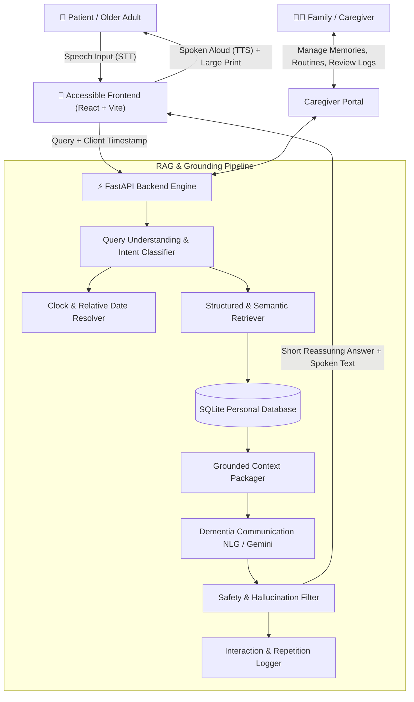

# ATTI — Dementia Memory Assistant 🧠🎙️

> **Project Synopsis & Implementation**  
> **Institution:** Delhi Technical Campus, Greater Noida (Affiliated to GGSIPU)  
> **Department:** Department of Computer Science & Engineering  
> **Students:** Parul (Enrollment No. 20118002723), Mahek Aghija (Enrollment No. 04518002723)  
> **Project Guide:** Mr. Upendra Pandey (Assistant Professor)  
> **Academic Year:** 2026–27  

---

## 1. Overview & Motivation

Dementia progressively impairs short-term memory, orientation, and recall of daily routines, while long-term memory and familiar life history are often better preserved. Conventional tools (calendars, to-do lists, reminder apps) require typing, navigating complex screens, and remembering menus—all of which pose high cognitive barriers for people with memory decline.

**ATTI (Dementia Memory Assistant)** reverses this burden: **the assistant adapts to the person**. 
- The user simply taps a single large glowing button (or speaks naturally) to ask questions like:
  - *"What am I supposed to do this afternoon?"*
  - *"Who is Rahul?"*
  - *"Where did I put my glasses?"*
  - *"Did I take my medicine?"*
- The assistant delivers a short, simple, reassuring response **both spoken aloud (TTS) and displayed in large, accessible print**.
- **Strict Grounded RAG & Safety**: Answers are strictly grounded in verified personal records. When information is missing, the assistant **never hallucinates**—it gently replies:  
  `"I am not sure — would you like me to ask your caregiver Rahul?"`

---

## 2. System Architecture



---

## 3. Key Implemented Modules

### 3.1 Patient Voice-First Interface
- **Accessible Design**: High visual contrast, large typography, calm color palette (sky blues and soft emeralds).
- **Single-Tap Voice**: Web Speech API speech recognition (STT) with pulsating visual feedback when listening.
- **Natural Spoken Delivery (TTS)**: Answers read aloud in a gentle, slightly paced tone (0.92x rate) for cognitive ease, with a 1-tap "Listen Again" replay button.
- **Orientation & Scheduled Routine Banner**: Live date, day of week, digital clock, and proactive "Next Up" activity card.
- **Tap-to-Ask Suggestions**: Pill buttons for common questions when finding words is difficult.

### 3.2 Grounded Retrieval-Augmented Generation (RAG)
- **Zero-Hallucination Dementia Engine**: Answers strictly from stored personal records.
- **Date Arithmetic Resolver**: Resolves relative time words (*"today"*, *"tomorrow"*, *"this afternoon"*, *"tonight"*) against the user's local clock.
- **Dementia Communication Guidelines**:
  1. Maximum 1–2 short sentences.
  2. One piece of information at a time.
  3. Calm, respectful tone without patronizing language.
  4. Explicit day and time (*"Today is Wednesday. Your appointment is at 5:00 PM."*).
  5. Gentle fallback when data is missing: *"I am not sure — would you like me to ask your caregiver?"*.

### 3.3 Caregiver Management Portal
- **Overview & Repetition Analytics**:
  - Tracks total interactions and grounded accuracy rate.
  - **Repetitive Question Detection**: Identifies how many times the patient asked the same question, offering crucial clinical insights into memory progression.
  - **Unanswered Questions Log**: Highlights queries that triggered fallbacks so caregivers can add missing facts with one click.
- **People & Family Directory**: Stored names, relationship, phone numbers, visit times, and personal notes.
- **Daily Routines & Schedules**: Morning, afternoon, and evening routines with time badges.
- **Medication Management**: Dosage, purpose, instructions, and *"Mark Taken Today"* status logging.
- **Everyday Items (Lost & Found)**: Locations for glasses, keys, cane, and phone.
- **Reminiscence Therapy & Life Stories**: Preserving precious memories (career, marriage, childhood trips) to stimulate identity and comfort.

---

## 4. Technologies Used

| Layer | Technology |
|---|---|
| **Frontend** | React 18, TypeScript, Tailwind CSS, Lucide Icons, Vite |
| **Speech STT / TTS** | Web Speech API (`SpeechRecognition` & `SpeechSynthesis`) |
| **Backend** | Python 3, FastAPI, Uvicorn, Pydantic v2 |
| **Database** | SQLite with SQLAlchemy ORM |
| **AI / NLP** | Rule & Semantic Intent Classifier, Date Resolver, Grounded Dementia NLG, Google Gemini API integration |
| **Scheduling** | APScheduler for routine triggers |

---

## 5. Getting Started

### Quick Start (One Command)
Run the automated runner script:
```bash
./start.sh
```

This will launch:
- **FastAPI Backend**: `http://127.0.0.1:8000` (Swagger docs at `/docs`)
- **React Frontend**: `http://127.0.0.1:5173`

### Manual Execution

1. **Backend**:
   ```bash
   cd backend
   source venv/bin/activate
   python run.py
   ```

2. **Frontend**:
   ```bash
   cd frontend
   npm run dev
   ```

---

## 6. API Endpoints

- `POST /api/assistant/query` — Processes speech/text question, runs RAG, returns grounded answer.
- `GET /api/assistant/prompt-suggestions` — Returns contextual quick-tap prompts.
- `GET /api/assistant/status` — Assistant online and engine status.
- `GET /api/routines/current-banner` — Current time and active/next scheduled routine.
- `GET /api/routines` / `POST /api/routines` — Daily schedule CRUD.
- `GET /api/routines/medications` — Medications and dosage schedules.
- `POST /api/routines/medications/{id}/log-taken` — Logs medication taken.
- `GET /api/memories/people` — Family, doctor, and friend profiles.
- `GET /api/memories/items` — Everyday item locations.
- `GET /api/memories/events` — Life events and reminiscence memories.
- `GET /api/logs/analytics` — Caregiver analytics (repetition frequency, fallback rate).
